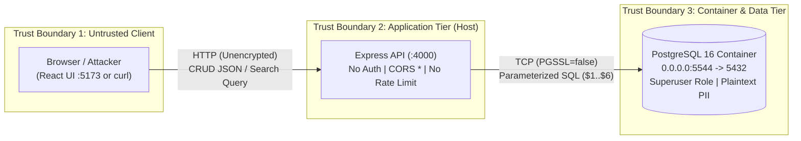

# Birthday Memory — Application Security Threat Model (Phase B1)

## 1. System Overview & Assets

Birthday Memory is a three-tier web application consisting of a React/Vite frontend (`client/`, port `5173`), an Express REST API (`server/`, port `4000`), and a PostgreSQL 16 database running in Docker (`docker-compose.yml`, host port `5544` mapped to container port `5432`).

### Primary Assets to Protect
* **Personally Identifiable Information (PII):** Full names, birthdates, phone numbers, and email addresses stored in the `birthdays` table.
* **Database Credentials & Access:** Superuser credentials (`birthday:birthday`) and direct network access to PostgreSQL.
* **API Integrity & Availability:** Protection against unauthorized data tampering, bulk exfiltration, and denial of service.

---

## 2. Data Flow Diagram & Trust Boundaries

### Trust Boundaries Identified
1. **Client to Express API (`TB1 -> TB2`):** Completely open. Any origin or unauthenticated script can call `/api/birthdays` with no credentials, rate limits, or CORS restrictions.
2. **Express API to PostgreSQL (`TB2 -> TB3`):** Traffic runs in plaintext by default (`PGSSL=false`). When SSL is enabled, `rejectUnauthorized: false` disables certificate checks. The API also connects with a schema-modifying superuser role.
3. **Host Network to Docker Container (`TB3`):** Docker binds `5544:5432` to `0.0.0.0` by default, exposing PostgreSQL beyond `localhost`, with no dropped Linux capabilities or resource limits.

---

## 3. STRIDE Threat Analysis

| Category | Threat / Vulnerability | Domain & Evidence | Severity |
| :--- | :--- | :--- | :--- |
| **Spoofing** | **Missing Authentication & Authorization:** `/api/birthdays` has zero auth middleware; any unauthenticated client can read, add, edit, or delete all records. | API — `server/src/index.js:22`, `server/src/routes.js:19-148`, `security/baseline/api_birthdays_unauth_before.txt` | **Critical** |
| **Spoofing** | **Hardcoded Default Credentials:** Default user/password (`birthday`/`birthday`) are committed in source code and Compose config. | Database & Container — `server/src/db.js:11-12`, `server/.env.example:10-11`, `docker-compose.yml:6-9` | **Critical** |
| **Spoofing** | **IP Spoofing via `proxy-addr`:** Vulnerable dependency allows bypassing IP-based rate limits and forging audit log IPs via IPv4-mapped IPv6 addresses. | Dependencies — `security/baseline/npm_audit_server_before.txt` (`GHSA-jqcg-44mw-7w3h`) | **Critical** |
| **Tampering** | **Wide-Open CORS:** `app.use(cors())` allows requests from any origin, enabling malicious third-party websites to interact with the API from a victim's browser. | API — `server/src/index.js:10` | **High** |
| **Tampering** | **Broken TLS Verification:** Database connections run unencrypted by default (`PGSSL=false`), and enabling SSL uses `{ rejectUnauthorized: false }`, allowing Man-in-the-Middle interception. | Database — `server/src/db.js:17`, `server/.env.example:15` | **High** |
| **Tampering** | **Loose Input Type & Size Handling:** `express.json()` has no payload size limit; `validate.js` coerces non-strings via `String(...)` and enforces no max length on `email`. | API — `server/src/index.js:11`, `server/src/validate.js:23-49` | **Medium** |
| **Repudiation** | **Zero Audit Logging:** `POST`, `PUT`, and `DELETE` actions leave no record of who modified or deleted PII, or when it happened. | API — `server/src/routes.js:80-148` | **High** |
| **Information Disclosure** | **Unbounded Bulk Exfiltration:** `GET /api/birthdays` and `GET /api/birthdays/upcoming` have no `LIMIT` or pagination, allowing full table dumps in one request. | API — `server/src/routes.js:47-55, 68` | **High** |
| **Information Disclosure** | **Plaintext PII at Rest:** Names, birthdates, phone numbers, and emails are stored unencrypted in Postgres (`pgcrypto` is installed only for UUID generation). | Database — `server/src/db.js:35-48` | **Medium** |
| **Information Disclosure** | **Health Endpoint Leaks Internal Details:** `/api/health` returns the database name (`thebirthdates`) on 200 and raw `error.message` on 503. Missing `helmet` exposes `X-Powered-By: Express`. | API — `server/src/index.js:7-20` | **Low** |
| **Denial of Service** | **No Rate Limiting & Vulnerable Parsers:** No request throttling on any endpoint, combined with DoS CVEs in `body-parser` (High) and `qs` (Moderate). | API & Dependencies — `server/src/index.js`, `npm_audit_server_before.txt` | **High** |
| **Denial of Service** | **Missing Container Resource Limits:** Postgres container has no CPU or memory caps, risking host exhaustion. | Container — `docker-compose.yml:2-18` | **Medium** |
| **Elevation of Privilege** | **Over-Privileged DB Role:** App runtime pool runs DDL (`CREATE EXTENSION`, `CREATE TABLE`, `CREATE INDEX`) as the Postgres superuser instead of a least-privilege role. | Database — `server/src/db.js:34-62`, `docker-compose.yml:8` | **High** |
| **Elevation of Privilege** | **Unhardened Container & Host Binding:** Port `5544:5432` binds to `0.0.0.0`, uses a floating `postgres:16-alpine` tag, and omits `no-new-privileges` and `cap_drop: [ALL]`. | Container — `docker-compose.yml:3, 10-18` | **High** |

*(Note on Client Audit: `npm_audit_client_before.txt` flagged High CVEs in `vite` and `source-map-js`. Because these affect the local development server and build toolchain rather than the production static bundle, their production risk is lower, though both will still be patched.)*

---

## 4. Tested — Not Vulnerable (False-Positive Verification)

* **SQL Injection (Tested — Not Vulnerable):** Every query in `server/src/routes.js` (lines `28-55`, `86-91`, `108-126`, `141-143`) uses parameterized placeholders (`$1`–`$6`), and `:id` parameters are validated against `UUID_RE` (line `8`). Baseline testing with `GET /api/birthdays?q=' OR '1'='1` returned `HTTP/1.1 200 OK` with an empty array `[]` (`security/baseline/sqli_test_before.txt`), confirming user input is treated strictly as data.
* **Stack Trace Leaks in Global Error Handler (Not Vulnerable):** `server/src/index.js:29-32` logs errors server-side and returns a generic `500` JSON message to the client.

---

## 5. Prioritized Remediation Roadmap (Phase B2)

1. **Patch Vulnerable Dependencies (Server & Client):** Run `npm audit fix` to clear the Critical `proxy-addr` IP spoofing flaw and High/Moderate DoS CVEs before adding rate limiting.
2. **Harden Domain 3 (Container & Secrets):** Remove hardcoded credentials from `docker-compose.yml` (move to untracked `.env`), bind Postgres strictly to `127.0.0.1:5544:5432`, pin the image version, drop Linux capabilities (`cap_drop: [ALL]`), add `no-new-privileges:true`, and set memory/CPU limits.
3. **Harden Domain 2 (Database & Least Privilege):** Remove hardcoded fallback passwords from `server/src/db.js`, fix `PGSSL` certificate validation (`rejectUnauthorized: true`), separate schema initialization from runtime queries, and create a least-privilege Postgres app role limited to `SELECT`, `INSERT`, `UPDATE`, and `DELETE`.
4. **Harden Domain 1 (Express API):** Add API authentication middleware (and update the React client so the app still works end-to-end), restrict CORS to an explicit origin allowlist, add `helmet` security headers, add rate limiting and JSON payload size limits, enforce pagination/`LIMIT` on reads, tighten `validate.js` type/length checks, sanitize `/api/health`, and add structured audit logging for mutations.
